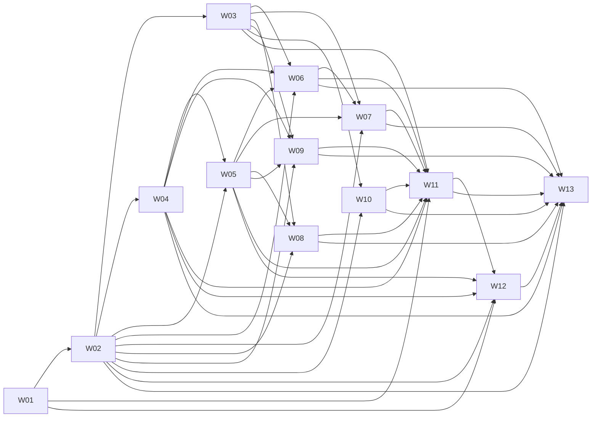

# TASK_DAG

`scripts/build_waves.py`가 `TASK_MANIFEST.csv`와 `TASK-*.md`의 Depends On에서 만든 파일이다(생성 2026-10-04T03:54:34Z). 직접 고치지 않는다.

- Task 56개, 의존 간선 151개, 순환 의존성 0개
- 최장 의존 경로 깊이 10

## Task별 의존

| Task | Wave | 깊이 | Depends On |
|---|---|---|---|
| `FND-TEST-TOOLING` | W01 | 0 | - |
| `DATA-JOBSITES` | W02 | 0 | - |
| `DATA-MBTI-ATTITUDE` | W02 | 0 | - |
| `DATA-RECOMMENDATIONS` | W02 | 0 | - |
| `FND-TOKENS` | W02 | 1 | `FND-TEST-TOOLING`(W01) |
| `FND-FEEDBACK` | W02 | 2 | `FND-TOKENS`(W02) |
| `FND-ROOT-REDIRECT` | W03 | 2 | `FND-TOKENS`(W02) |
| `FND-SECTIONS` | W03 | 3 | `FND-TOKENS`(W02), `FND-FEEDBACK`(W02) |
| `FND-SESSION-GUARD` | W03 | 3 | `FND-FEEDBACK`(W02) |
| `FND-SHELL` | W03 | 2 | `FND-TOKENS`(W02) |
| `FND-NOT-FOUND` | W03 | 3 | `FND-TOKENS`(W02), `FND-SHELL`(W03), `FND-FEEDBACK`(W02) |
| `LIB-INPUT-VALIDATION` | W04 | 0 | - |
| `DB-SCHEMA-BASE` | W04 | 1 | `LIB-INPUT-VALIDATION`(W04) |
| `DB-RLS-BASE` | W04 | 2 | `DB-SCHEMA-BASE`(W04) |
| `LIB-JOBLINK-BUILDER` | W04 | 1 | `DATA-JOBSITES`(W02) |
| `LIB-SCORING-ENGINE` | W05 | 1 | `LIB-INPUT-VALIDATION`(W04) |
| `LIB-DEDUCTION-REASONS` | W05 | 2 | `LIB-SCORING-ENGINE`(W05) |
| `LIB-RECO-MAPPER` | W05 | 3 | `DATA-RECOMMENDATIONS`(W02), `LIB-DEDUCTION-REASONS`(W05) |
| `DB-ACCESS` | W05 | 4 | `DB-RLS-BASE`(W04), `LIB-DEDUCTION-REASONS`(W05), `LIB-RECO-MAPPER`(W05) |
| `API-DIAG-SUBMIT` | W06 | 5 | `LIB-INPUT-VALIDATION`(W04), `LIB-SCORING-ENGINE`(W05), `LIB-DEDUCTION-REASONS`(W05), `LIB-RECO-MAPPER`(W05), `DB-ACCESS`(W05) |
| `CMP-FIELDS` | W06 | 3 | `FND-TOKENS`(W02), `FND-FEEDBACK`(W02) |
| `FEAT-OBS-EVENTS` | W06 | 4 | `FND-SESSION-GUARD`(W03) |
| `CMP-DIAG-FORM` | W06 | 6 | `CMP-FIELDS`(W06), `LIB-INPUT-VALIDATION`(W04), `API-DIAG-SUBMIT`(W06), `FND-SESSION-GUARD`(W03), `FEAT-OBS-EVENTS`(W06) |
| `PAGE-SCR001` | W06 | 7 | `FND-SHELL`(W03), `FND-SECTIONS`(W03), `FND-ROOT-REDIRECT`(W03), `CMP-FIELDS`(W06), `CMP-DIAG-FORM`(W06), `API-DIAG-SUBMIT`(W06), `FEAT-OBS-EVENTS`(W06) |
| `API-DIAG-REASONS` | W07 | 5 | `DB-ACCESS`(W05) |
| `API-DIAG-RESULT` | W07 | 5 | `DB-ACCESS`(W05) |
| `CMP-DEDUCTION-CHIPS` | W07 | 2 | `FND-TOKENS`(W02) |
| `CMP-REASON-DRAWER` | W07 | 6 | `FND-FEEDBACK`(W02), `API-DIAG-REASONS`(W07), `FEAT-OBS-EVENTS`(W06) |
| `CMP-SCORE-HERO` | W07 | 4 | `FND-SECTIONS`(W03) |
| `PAGE-SCR002` | W07 | 7 | `FND-SHELL`(W03), `FND-SECTIONS`(W03), `FND-SESSION-GUARD`(W03), `CMP-SCORE-HERO`(W07), `CMP-DEDUCTION-CHIPS`(W07), `CMP-REASON-DRAWER`(W07), `API-DIAG-RESULT`(W07), `API-DIAG-REASONS`(W07), `FEAT-OBS-EVENTS`(W06) |
| `API-DIAG-RECOMMENDATIONS` | W08 | 5 | `DB-ACCESS`(W05) |
| `CMP-RECO-GRID` | W08 | 6 | `FND-FEEDBACK`(W02), `API-DIAG-RECOMMENDATIONS`(W08) |
| `PAGE-SCR003` | W08 | 7 | `FND-SHELL`(W03), `FND-SECTIONS`(W03), `FND-SESSION-GUARD`(W03), `CMP-RECO-GRID`(W08), `API-DIAG-RECOMMENDATIONS`(W08), `DATA-RECOMMENDATIONS`(W02) |
| `API-DIAG-JOBS` | W09 | 5 | `DB-ACCESS`(W05), `LIB-JOBLINK-BUILDER`(W04) |
| `CMP-JOB-SITES` | W09 | 6 | `FND-FEEDBACK`(W02), `LIB-JOBLINK-BUILDER`(W04), `API-DIAG-JOBS`(W09) |
| `PAGE-SCR004` | W09 | 7 | `FND-SHELL`(W03), `FND-SECTIONS`(W03), `FND-SESSION-GUARD`(W03), `CMP-JOB-SITES`(W09), `API-DIAG-JOBS`(W09), `DATA-JOBSITES`(W02) |
| `API-ATTITUDE` | W10 | 1 | `DATA-MBTI-ATTITUDE`(W02) |
| `CMP-ATTITUDE-PANEL` | W10 | 3 | `API-ATTITUDE`(W10), `FND-FEEDBACK`(W02) |
| `CMP-MBTI-GRID` | W10 | 3 | `DATA-MBTI-ATTITUDE`(W02), `FND-FEEDBACK`(W02) |
| `PAGE-SCR005` | W10 | 4 | `FND-SHELL`(W03), `FND-SECTIONS`(W03), `CMP-MBTI-GRID`(W10), `CMP-ATTITUDE-PANEL`(W10), `API-ATTITUDE`(W10), `DATA-MBTI-ATTITUDE`(W02) |
| `E2E-DIAG-FLOW` | W11 | 8 | `PAGE-SCR001`(W06), `PAGE-SCR002`(W07), `API-DIAG-SUBMIT`(W06), `FND-TEST-TOOLING`(W01) |
| `E2E-JOBS-ATTITUDE` | W11 | 8 | `PAGE-SCR003`(W08), `PAGE-SCR004`(W09), `PAGE-SCR005`(W10), `FND-TEST-TOOLING`(W01) |
| `E2E-PUBLIC-SMOKE` | W11 | 8 | `PAGE-SCR001`(W06), `PAGE-SCR002`(W07), `PAGE-SCR003`(W08), `PAGE-SCR004`(W09), `PAGE-SCR005`(W10), `FND-NOT-FOUND`(W03), `FND-TEST-TOOLING`(W01) |
| `TEST-RLS-BASIC` | W11 | 5 | `DB-RLS-BASE`(W04), `DB-ACCESS`(W05) |
| `UNIT-JOBLINK` | W11 | 2 | `LIB-JOBLINK-BUILDER`(W04), `FND-TEST-TOOLING`(W01) |
| `UNIT-MBTI-MAP` | W12 | 1 | `DATA-MBTI-ATTITUDE`(W02), `FND-TEST-TOOLING`(W01) |
| `UNIT-REASONS-RECO` | W12 | 4 | `LIB-DEDUCTION-REASONS`(W05), `LIB-RECO-MAPPER`(W05), `DATA-RECOMMENDATIONS`(W02), `FND-TEST-TOOLING`(W01) |
| `UNIT-SCORING` | W12 | 2 | `LIB-SCORING-ENGINE`(W05), `FND-TEST-TOOLING`(W01) |
| `UNIT-VALIDATION` | W12 | 1 | `LIB-INPUT-VALIDATION`(W04), `FND-TEST-TOOLING`(W01) |
| `OPS-CI` | W12 | 5 | `FND-TEST-TOOLING`(W01), `UNIT-SCORING`(W12), `UNIT-VALIDATION`(W12), `UNIT-REASONS-RECO`(W12), `UNIT-JOBLINK`(W11), `UNIT-MBTI-MAP`(W12) |
| `MANUAL-JOBLINKS` | W13 | 7 | `DATA-JOBSITES`(W02), `CMP-JOB-SITES`(W09) |
| `MANUAL-PERF` | W13 | 7 | `API-DIAG-SUBMIT`(W06), `CMP-DIAG-FORM`(W06) |
| `OPS-VERCEL-DB-CHECK` | W13 | 8 | `PAGE-SCR001`(W06), `PAGE-SCR002`(W07), `PAGE-SCR003`(W08), `PAGE-SCR004`(W09), `PAGE-SCR005`(W10), `DB-RLS-BASE`(W04), `API-DIAG-SUBMIT`(W06) |
| `MANUAL-LOGS-OBS` | W13 | 9 | `DB-SCHEMA-BASE`(W04), `FEAT-OBS-EVENTS`(W06), `OPS-VERCEL-DB-CHECK`(W13) |
| `MANUAL-PREVIEW` | W13 | 9 | `PAGE-SCR001`(W06), `PAGE-SCR002`(W07), `PAGE-SCR003`(W08), `PAGE-SCR004`(W09), `PAGE-SCR005`(W10), `OPS-VERCEL-DB-CHECK`(W13) |
| `RELEASE-CHECK` | W13 | 10 | `MANUAL-PERF`(W13), `MANUAL-PREVIEW`(W13), `MANUAL-JOBLINKS`(W13), `MANUAL-LOGS-OBS`(W13), `E2E-PUBLIC-SMOKE`(W11), `E2E-DIAG-FLOW`(W11), `E2E-JOBS-ATTITUDE`(W11), `OPS-CI`(W12), `TEST-RLS-BASIC`(W11) |

## Wave 간 의존

