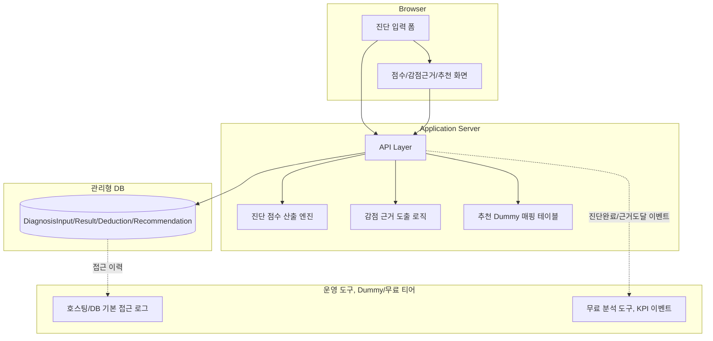
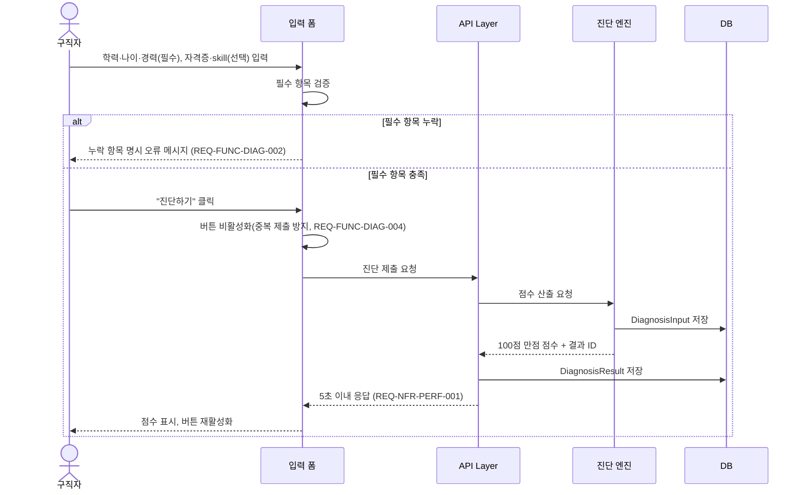
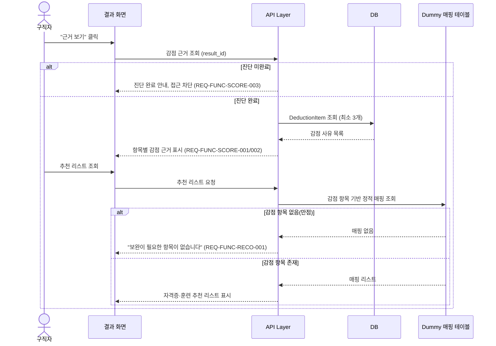
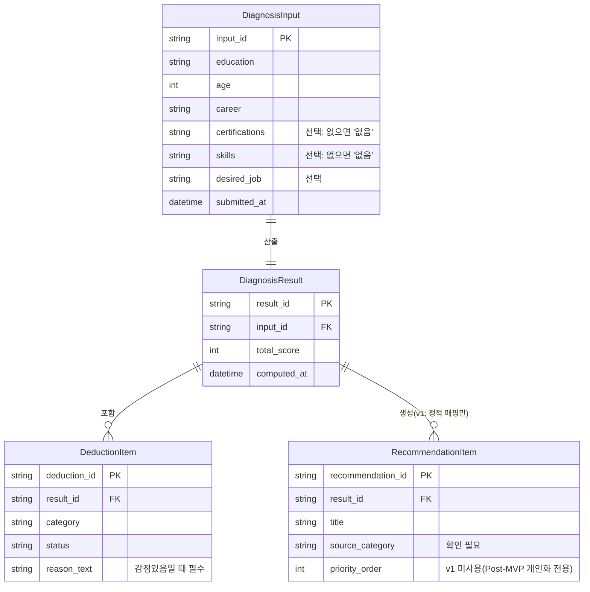

# Software Requirements Specification (SRS) — AI 기반 구직역량 진단·매칭 서비스

**Document ID:** SRS-JOBSEEK-001
**Revision:** 1.2 (UI/UX 승인 Screen 반영)
**Date:** 2026-10-03
**Standard:** ISO/IEC/IEEE 29148:2018 (구조 정합화, `05_SRS_Travel_v1.md` 형식 참조)
**Status:** Draft — MVP 릴리스 준비용 (일부 Open Questions 미해결로 "완전 확정" 아님). 본 개정은 `docs/02_SRS_BASELINE.md`의 Requirement를 변경·삭제하지 않고 화면·Route 구조만 연결한다

| 항목 | 내용 |
|---|---|
| 프로젝트명 | AI 기반 구직역량 진단·매칭 서비스 (v1 MVP) |
| 기반 문서 | `PRD_Job seeking.md`, `SRS_Drafts/SRS_Job seeking_integrated_v0_4.md`(v0.5), `SRS_Drafts/04_SRS_Job seeking_review.md`, `05_SRS_Job seeking.md`(전신 문서) |
| 승인 범위 | 구현·운영 가능성 재검토(채팅, 2026-09-19)의 19개 요구사항 제안 전부 승인. 삭제로 확정된 요구사항 없음 |
| 기본 언어 | 한국어 (`ko-KR`) |
| 기본 플랫폼 | 반응형 웹 (1인 개발 체제, 무료/저비용 인프라 전제) |
| Owner | 서비스 운영자(1인 개발자) |

### 변경 요약 (1.1 → 1.2, UI/UX 승인 Screen 반영)

| 변경 | 내용 |
|---|---|
| Requirement | REQ-FUNC 16개(`ADMIN` 포함)와 REQ-NFR 8개를 모두 유지했다. 삭제·문구 변경 없음 |
| 화면 구조 | 공개 Route 6개를 승인 Screen 5개(SCR-001~005)로 통합했다. `/diagnosis/result/reasons`는 SCR-002의 감점 근거 Drawer로 통합하고 별도 Route를 두지 않는다(§3.6) |
| UI Route Contract | §3.6.1~3.6.3에 Screen별 Route·Page Entry·기술 Route·필수 이동 관계를 추가했다 |
| Traceability | §5.3에 Requirement별 Screen·Route 연결을 추가했다. 상세 표는 `docs/UIUX_TRACEABILITY.md` |
| Release Acceptance Criteria | §9.5에 UI 릴리스 기준을 추가했다 |
| 구현 상태 | 구현된 Screen·API가 없다. 모든 IMPLEMENT 요구사항은 `NOT_IMPLEMENTED`이며 EXCLUDED 항목은 `docs/PROJECT_SCOPE.md` 분류를 따른다 |

### 변경 요약 (05 → 06, 이전 개정)

`05_SRS_Job seeking.md`는 요구사항 명세(§7~§14)는 상세했으나, 참조 SRS(`05_SRS_Travel_v1.md`)가 갖춘 **구조적 요소**가 없었다. 이번 개정에서 다음을 신규 추가했다(요구사항 내용 자체는 05판을 그대로 승계, 삭제 없음).

| 신규 추가 섹션 | 사유 |
|---|---|
| §1.4 References (외부 표준·법령·API 링크) | 05판에는 참조 문서 목록이 PRD/SRS 초안뿐, 외부 표준·법령 근거 없음 |
| §2 Stakeholders and Permissions (역할 권한 매트릭스) | 05판 §3 Stakeholders는 역할·책임만 있고 기능별 권한 매트릭스 없음 |
| §3 System Context (아키텍처 다이어그램, 기술 스택, 클라이언트 기준, 라우트 인벤토리, Use Case 표) | 05판 §4 System Context는 경계 서술과 Mermaid Context Diagram 1개뿐, 구현 아키텍처·라우트·유스케이스가 없어 개발 착수 기준으로 불충분 |
| §3.7 Core Interaction Sequences (Sequence Diagram) | 05판 §11은 "v0.5 다이어그램 참조"로 위임되어 본 문서 자체로는 시퀀스가 없음 — 본 문서에 직접 포함 |
| §6 Appendix — Internal API, Data Model 표 형식 | 05판 §9 API Requirements는 오퍼레이션명만 나열, Request/Response·데이터 모델 필드 정의가 v0.5로 위임되어 단독 문서로 불완전 |

---

## 1. Introduction

### 1.1 Purpose

본 문서는 `PRD_Job seeking.md`에 정의된 서비스의 **MVP(v1) 릴리스 범위**를 확정하고, 구현·테스트·운영에 필요한 요구사항을 정의한다. 서류 탈락 원인을 모른 채 같은 이력서를 반복 수정하는 구직자에게, 학력·경력·자격증·skill 기반 100점 만점 점수와 항목별 감점 근거를 제공하여 자신의 역량 수준을 객관적으로 확인시키는 것이 핵심 가치다. (출처: PRD §1)

본 SRS의 독자는 개발자(1인), QA 역할 수행자, PO(운영자 본인)다. 각 요구사항은 고유 ID, 우선순위, 원천, 검증 가능한 수용 기준을 갖는다.

### 1.2 Scope

#### 1.2.1 In-Scope (MVP v1)

| ID | 범위 | 구현 방식(v1) |
|---|---|---|
| **IS-01** | 입력 폼 + 진단 점수 산출 엔진 (학력·나이·경력 필수, 자격증·skill 선택) | 정식 구현 |
| **IS-02** | 항목별 감점 근거 상세 화면 (최소 3개 이상) | 정식 구현 |
| **IS-03** | 자격증·훈련 추천 리스트 (룰 기반 정적 매핑) | Dummy: 내부 하드코딩 소규모 매핑 테이블 |
| **IS-04** | 개인식별정보 암호화 저장·접근 제어 | 관리형 DB 기본 암호화 활용 |
| **IS-05** | 개인식별정보 접근 로그, KPI 이벤트 로깅 | Dummy: 호스팅/DB 기본 로그, 무료 분석 도구 |
| **IS-06** | 희망 직무 기반 외부 구인정보 검색 연결 (잡코리아·사람인·원티드·워크넷·IT 전문 구인 사이트 등) | 정식 구현(링크 생성 로직만). 매칭·추천 알고리즘 없음 — 입력된 희망 직무/키워드를 각 사이트의 검색 URL 쿼리 파라미터에 반영해 새 탭으로 이동 |
| **IS-07** | MBTI 기반 직무 수행 태도 보조 지표 (SCR-005, `/diagnosis/attitude`) | Dummy: 16개 MBTI 유형 → 직무 수행 태도 점수·설명의 정적 매핑 테이블(`src/data`). **핵심 역량 진단 100점 점수와 완전히 분리된 별도 보조 지표**이며 합산·가중치 반영 없음 |

> ⚠️ **IS-07 리스크 노트(2026-10-03, 사용자 요청으로 편입)**: PRD §4는 "성향이 아니라 항목별 근거가 있는 직무 적합도 점수를 제공한다는 점"을 서비스의 유일한 Differential Value로 명시하고, PRD §2는 "무료 성향검사는 성향 라벨만 제공할 뿐 직무 적합도나 감점 사유를 보여주지 않는다"는 점을 경쟁 열위 대안의 한계로 지적한다. MBTI 기반 지표는 이 비판 대상과 유사한 방식(자기보고 유형 선택 → 정적 룰 기반 점수)이므로, 핵심 역량 점수(REQ-FUNC-DIAG-001)와 **절대 합산·혼용하지 않고 "참고용 보조 지표"로 명확히 분리 표기**해 PRD의 차별화 주장이 희석되지 않도록 한다. PRD 본문은 이번 편입에서 수정하지 않으며, 재검토 시 PRD §5에 정식 반영할지 별도 결정 필요(OQ-23).

#### 1.2.2 Out-of-Scope

| ID | 배제 범위 | 이유 |
|---|---|---|
| **OS-01** | 추천 개인화 알고리즘 (REQ-FUNC-PERSONALIZE-001~003) | PRD §10-2가 스스로 "게이트 통과 절차 없이 예외 편입, VPS Differential Value 미해당"으로 명시. Post-MVP 이연(삭제 아님) |
| **OS-02** | 무료 진단 → 유료 전환 구조 | 지불 의향 미실측 |
| **OS-03** | 채용공고 매칭·추천(알고리즘 기반 공고 추천/적합도 산정) | VPS·MoSCoW에 근거 없음. **범위 경계 명확화(2026-10-03)**: IS-06(희망 직무 기반 외부 검색 연결)은 매칭·추천 로직이 전혀 없는 단순 링크 생성(사용자가 입력한 희망 직무 문자열을 외부 사이트 검색 URL에 그대로 전달)이므로 OS-03 제외 대상이 아니다. 특정 공고를 골라 보여주거나 적합도를 계산하는 기능은 계속 Out-of-Scope로 유지한다. |
| **OS-04** | 커뮤니티/스터디 기능 | 근거 없음 |
| **OS-05** | 사회적 Job 기반 기능 | VPS에서 사회적 Job 자체가 확인 필요 상태 |
| **OS-06** | 로그인/인증 위임 | v1의 어떤 기능도 로그인을 전제하지 않음(재검토 승인) |
| **OS-07** | 관리자/운영자 전용 화면 | PRD 전체에 근거 없음 |

#### 1.2.3 Constraints

| ID | 제약사항 | 유형 |
|---|---|---|
| **CON-01** | 1인 개발 체제 — 복잡한 서버 인프라·유료 API 의존 최소화 | 조직/기술 |
| **CON-02** | 베타 테스트는 무료/저비용 도구로만 진행 | 운영 |
| **CON-03** | 지불 전환 관련 기능은 이번 범위에서 설계하지 않음 | 제품 범위 |
| **CON-04** | 추천 리스트·감사 로그·KPI 로깅은 Dummy/무료 도구로 구현 | 구현 방식 |
| **CON-05** | 개인식별정보는 암호화 저장하고 제3자 무단 접근을 차단한다 | 보안/개인정보 |
| **CON-06** | 월 비용 구체 상한 미정 | [결정 필요] |
| **CON-07** | v1은 계정/로그인 엔터티를 만들지 않는다 | 아키텍처 |

#### 1.2.4 Assumptions

| ID | 가정 | 검증 |
|---|---|---|
| **ASM-01** | 3개 세그먼트(청년/경력단절여성/중장년) 공통 서비스를 지향하나 Pain·Job은 청년 세그먼트 인터뷰 1건에서만 확인됨 | 추가 세그먼트 인터뷰 필요 |
| **ASM-02** | v1은 1인 개발 체제, 무료/저비용 툴·Dummy 구현을 전제로 한다 | PRD §8 |
| **ASM-03** | 채점 가중치·감점 사유 로직은 출시 전 확정 가능하다 | OQ-08, OQ-13 (Release Blocking) |

#### 1.2.5 Contingency Plans

| ID | 상황 | 대응 |
|---|---|---|
| **CP-01** | 5초 응답 시간 초과 | 타임아웃 UX 처리 방식 [결정 필요] — 출시 전 정의 권고 |
| **CP-02** | 베타 가동률 95% 미달 | 측정 도구·주기 미정 — 무료 업타임 모니터링 도구로 임시 관찰(Dummy) |
| **CP-03** | 로그 기록 실패(감사 로그) | 처리 방식 [결정 필요] |
| **CP-04** | 네트워크 오류로 진단 제출 응답 미수신 | 버튼 재활성화 타임아웃 처리 방식 [결정 필요] |

### 1.3 Definitions

| 용어 | 정의 | 출처 |
|---|---|---|
| 진단 점수 | 학력·경력·자격증·skill 기반으로 산출되는 100점 만점 점수 | PRD §1, §5 |
| 감점 근거 | 진단 점수에서 항목별로 깎인 사유를 설명하는 정보 (최소 3개 이상) | PRD §5 |
| 룰 기반 로직 | 머신러닝이 아닌, 정해진 규칙에 따라 결과를 산출하는 방식 | PRD §5, §8 |
| Dummy 구현 | 정식 인프라·외부 연동 대신 하드코딩 데이터, 수동 프로세스, 무료 도구 등으로 대체한 v1 임시 구현 방식 | 재검토(2026-09-19) 도출 |
| MVP / Post-MVP | 본 문서에서 "MVP(v1)"는 이번 릴리스 범위, "Post-MVP"는 이연된 범위를 의미 | 재검토(2026-09-19) 도출 |
| AOS/DOS | PRD 내 우선순위 재채점·게이트 검증 절차를 지칭하는 용어(구체적 정의는 PRD에 없음) | PRD §5, §10 — [결정 필요] |
| 개인식별정보(PII) | 학력·경력·자격증 등 개인을 식별하거나 식별에 조합 가능한 정보 | PRD §7 |

### 1.4 References

| ID | 문서·서비스 | URL/경로 |
|---|---|---|
| **REF-01** | Job Seeking PRD v1.0 | `./PRD_Job seeking.md` |
| **REF-02** | 통합 SRS v0.5 | `./SRS_Drafts/SRS_Job seeking_integrated_v0_4.md` |
| **REF-03** | SRS 재검토 초안 | `./SRS_Drafts/04_SRS_Job seeking_review.md` |
| **REF-04** | 전신 SRS(v1.0) | `./05_SRS_Job seeking.md` |
| **REF-05** | ISO/IEC/IEEE 29148:2018 | https://www.iso.org/standard/72089.html |
| **REF-06** | 개인정보 보호법 | https://www.law.go.kr/법령/개인정보보호법 |
| **REF-07** | 구조 참조 SRS (Free Traveler) | `../../traveler/docs/05_SRS_Travel_v1.md` |

---

## 2. Stakeholders and Permissions

### 2.1 Stakeholders

| 역할 | 책임 | 관심사 | 출처 |
|---|---|---|---|
| 구직자 (최종 사용자) | 학력·나이·경력·자격증·skill 정보를 정확히 입력, 결과·감점 근거·추천 리스트 열람 | 5분 내 신뢰할 수 있는 점수·근거 확인 | PRD §1, §3, §5, §6 |
| 서비스 운영자(1인 개발자) | 서비스 전체 운영·배포·비용 관리, v1 Dummy 프로세스(수동 삭제, 접근 로그 확인 등) 수행 | 비용 상한 준수, 베타 가동률 유지, 보안·개인정보 보호 조치 이행 | PRD §7, §8 |

> v1은 관리자/운영 전용 역할·화면을 두지 않는다(PRD 근거 없음, OQ-01).

### 2.2 Role Permission Matrix

| 기능 | Guest(구직자) | 서비스 운영자 |
|---|:---:|:---:|
| 입력 폼 작성·진단 제출 | O | O(테스트 목적) |
| 진단 점수 열람 | O(해당 세션) | O |
| 감점 근거 상세 열람 | O(해당 세션) | O |
| 추천 리스트(Dummy 매핑) 열람 | O(해당 세션) | O |
| 과거 진단 이력 재조회 | 정책 미정(OQ-10) | — |
| 개인식별정보 접근 로그 확인 | X | O(호스팅/DB 기본 로그) |
| 매핑 테이블·채점 로직 변경 | X | O(코드 배포를 통해서만) |
| 개인정보 수동 삭제 처리 | X | O(임시 SOP, OQ-10) |

---

## 3. System Context and Interfaces

### 3.1 System Boundary (v1)

v1 시스템 경계는 "구직자가 입력한 학력·경력·자격증·skill 데이터를 받아 진단 점수·감점 근거·추천 리스트(Dummy 정적 매핑)를 산출·표시하는 범위"로 한정한다. 개인화 알고리즘과 인증/로그인은 경계 밖(Post-MVP)에 둔다. (출처: PRD §1, §5, 재검토 승인)

### 3.2 Architecture

### 3.3 Technology Stack

| Layer | Technology(v1 방침) | Responsibility |
|---|---|---|
| Web/API | 1인 개발 체제 표준 프레임워크(세부 스택 미정, [결정 필요]) | 폼 처리, 점수/근거/추천 API |
| Data | 관리형 DB(기본 저장 암호화 활용) | DiagnosisInput/Result/Deduction/Recommendation 저장 |
| 추천 매핑 | 코드 내 하드코딩 테이블(§5.5) | 감점 항목 → 자격증·훈련 매핑 |
| 로그/분석 | 호스팅·DB 기본 접근 로그, 무료 분석 도구 | 접근 감사(Dummy), KPI 이벤트(Dummy) |
| 배포 | 무료/저비용 호스팅 티어 | 운영 |

### 3.4 External Systems

| ID | 시스템 | 역할 | v1 결정 |
|---|---|---|---|
| **EXT-01** | 인증/로그인 위임 | 사용자 인증 | **Post-MVP** — v1 미포함 |
| **EXT-02** | 자격증·훈련 정적 매핑 데이터 소스 | 외부 매핑 데이터 | **v1 미연동** — 내부 Dummy 하드코딩 리스트 사용 |
| **EXT-03** | 운영 인프라 툴(호스팅/모니터링) | 배포·가동률 관찰 | 무료 티어 도구 사용(정식 요구사항 아님) |

> v1은 외부 시스템 연동을 포함하지 않는다. 아래 외부 인터페이스 표는 공란으로 유지한다(§4.3 결정에 따름).

| 목적 | 방향 | 전달 데이터 | 인증 | 실패 처리 | 재시도/폴백 |
|---|---|---|---|---|---|
| — | — | — | — | — | v1 해당 없음 |

### 3.5 Client Applications

| ID | 클라이언트 | 지원 기준 |
|---|---|---|
| **CLT-01** | 반응형 웹(모바일 포함) | 세부 브라우저 지원 기준 [결정 필요] |

### 3.6 Page/Screen Inventory

v1은 5개 디자인 Screen으로 구성한다. 기존의 별도 감점 근거 Route(`/diagnosis/result/reasons`)는 SCR-002 안의 Drawer(모바일은 하단 시트)로 통합한다.

| Screen | Route | 설명 | 구분 | Access |
|---|---|---|---|---|
| SCR-001 | `/diagnosis` | 진단 입력 폼(학력·나이·경력·자격증·skill·희망 직무) | 핵심 | Public |
| SCR-002 | `/diagnosis/result` | 진단 점수 결과(역량리포트) + 항목별 감점 근거 Drawer | 핵심 | Public(해당 세션) |
| SCR-003 | `/diagnosis/result/recommendations` | 자격증·훈련 추천 리스트(Dummy 매핑) | 핵심 | Public(해당 세션) |
| SCR-004 | `/diagnosis/result/jobs` | 희망 직무 기반 외부 구인정보 검색 연결(직무추천) | 핵심 | Public(해당 세션) |
| SCR-005 | `/diagnosis/attitude` | MBTI 기반 직무 수행 태도 보조 지표(직무수행태도 진단) | 보조 | Public |

#### 3.6.1 UI Route Contract

| Screen | Route | Page Entry | Page Owner Task | Preview |
|---|---|---|---|---|
| SCR-001 | `/diagnosis` | `src/app/diagnosis/page.tsx` | 필수 | 필수 (스타터 템플릿 사용 금지) |
| SCR-002 | `/diagnosis/result` | `src/app/diagnosis/result/page.tsx` | 필수 | 필수 |
| SCR-003 | `/diagnosis/result/recommendations` | `src/app/diagnosis/result/recommendations/page.tsx` | 필수 | 필수 |
| SCR-004 | `/diagnosis/result/jobs` | `src/app/diagnosis/result/jobs/page.tsx` | 필수 | 필수 |
| SCR-005 | `/diagnosis/attitude` | `src/app/diagnosis/attitude/page.tsx` | 필수 | 필수 |

- Route와 Page Entry는 각각 중복되지 않으며 Screen 수는 5개다.
- 기계 판독본은 `design-reference/SCREEN_ROUTE_CONTRACT.json`이고 화면별 영역·상태·금지 기능은 `design-reference/UI_CONTRACT.md`를 따른다.

#### 3.6.2 기술 Route (Screen 수에 포함하지 않음)

| Route | 용도 | 연결 API |
|---|---|---|
| `/` | `/diagnosis`로 redirect | — |
| `/api/diagnosis` | 진단 제출 | API-01 |
| `/api/diagnosis/{result_id}` | 진단 결과 재조회 | API-02 |
| `/api/diagnosis/{result_id}/reasons` | 감점 근거 데이터(SCR-002 Drawer가 사용) | API-03 |
| `/api/diagnosis/{result_id}/recommendations` | 추천 리스트 | API-04 |
| `/api/diagnosis/{result_id}/jobs` | 구인 사이트 링크 목록 | API-06 |
| `/api/attitude` | MBTI 보조 지표 | API-07 |
| `not-found` | 존재하지 않는 경로 안내 | — |

인증 콜백 Route는 만들지 않는다(OS-06, CON-07).

#### 3.6.3 필수 이동 관계

| From | To | 트리거 | 유형 |
|---|---|---|---|
| SCR-001 | SCR-002 | 진단하기 제출 성공 | Route |
| SCR-002 | SCR-002 | 근거 보기 | Drawer |
| SCR-002 | SCR-003 | 추천 확인하기 | Route |
| SCR-002 | SCR-004 | 희망 직무로 구인 사이트 찾기 | Route |
| SCR-002 | SCR-001 | 다른 정보로 다시 진단하기 | Route |
| SCR-003 | SCR-002, SCR-001 | 결과로 돌아가기, 다시 진단하기 | Route |
| SCR-004 | SCR-002, SCR-001 | 진단 결과로 돌아가기, 다시 진단하기 | Route |
| SCR-004 | 외부 구인 사이트 | 희망 직무로 검색하기 | 새 탭 |
| SCR-005 | SCR-001 | 핵심 역량 진단 시작하기 | Route |
| SCR-002, 003, 004 | SCR-001 | 진단 미완료 경고 CTA | Route |
| Header | SCR-001 ~ SCR-005 | 탭 5개 | Route |

### 3.7 Use Cases

| ID | Use Case | Actor | Related Requirements |
|---|---|---|---|
| **UC-01** | 진단 입력 및 점수 산출 | 구직자 | REQ-FUNC-DIAG-001~004 |
| **UC-02** | 항목별 감점 근거 확인 | 구직자 | REQ-FUNC-SCORE-001~003 |
| **UC-03** | 자격증·훈련 추천 리스트 확인 | 구직자 | REQ-FUNC-RECO-001 |
| **UC-04** | (Post-MVP) 추천 개인화 확인 | 구직자 | REQ-FUNC-PERSONALIZE-001~003 |
| **UC-05** | 개인정보 접근 감사 확인 | 서비스 운영자 | REQ-NFR-SEC-003 |
| **UC-06** | 희망 직무 기반 외부 구인정보 검색 연결 확인 | 구직자 | REQ-FUNC-JOBLINK-001 |
| **UC-07** | MBTI 선택 및 직무 수행 태도 보조 지표 확인 | 구직자 | REQ-FUNC-ATTITUDE-001~002 |

### 3.8 Core Interaction Sequences

#### 3.8.1 진단 제출 → 점수 산출

#### 3.8.2 감점 근거 및 추천 리스트 조회

---

## 4. Specific Requirements

> **Priority:** M=Must, S=Should. "시스템은"으로 시작하는 문장은 구현·검증 대상이다. Release 열이 "Post-MVP"인 항목은 요구사항 ID·명세를 보존만 하며 v1 출시 대상이 아니다.

### 4.1 Product Summary and Release Scope

- **v1(MVP) 핵심 가치**: 진단 점수 산출 + 항목별 감점 근거 제공 (Must 2건) + 자격증·훈련 추천(정적 매핑, Dummy 데이터) (Should 1건)
- **Post-MVP로 이연된 가치**: 추천 우선순위 개인화 (PRD §10-2가 스스로 미검증 예외 기능으로 명시)

### 4.2 핵심 데이터 엔터티 (v1)

> v1 범위에서는 계정 엔터티를 만들지 않는다(§3.4 인증 위임 Post-MVP).

#### 4.2.1 DiagnosisInput

| 필드 | 형식 | 필수 여부 | 출처 |
|---|---|---|---|
| input_id | 식별자 (형식 미정) | 필수 | 논리적 필요 |
| education | 문자열/코드 (형식 미정) | 필수 | PRD §5 |
| age | 숫자 | 필수 | PRD §5 |
| career | 문자열/기간 (형식 미정) | 필수 | PRD §5 |
| certifications | 목록 (형식 미정) | 선택(없으면 "없음") | PRD §5 (2026-09-19 수정) |
| skills | 목록 (형식 미정) | 선택(없으면 "없음") | PRD §5 (2026-09-19 수정) |
| desired_job | 문자열 | 선택(없으면 REQ-FUNC-JOBLINK-002 분기) | 결정 D-02 (2026-10-04) — DB 저장 |
| submitted_at | 일시 | 필수 | 논리적 필요 |

- **보존·삭제 정책(v1)**: 정식 자동화 정책은 [결정 필요](§7 OQ-10). **v1 임시 방침**: 정책 확정 전까지 운영자가 수동으로 주기 점검·삭제 (REQ-NFR-PRIV-002 참조).

#### 4.2.2 DiagnosisResult / DeductionItem / RecommendationItem

RecommendationItem의 `priority_order`는 v1에서 개인화(Post-MVP)가 비활성 상태이므로 사용하지 않는다(정적 매핑 순서만 존재).

#### 4.2.3 매핑/구성 데이터 — v1: 내부 Dummy 테이블

PRD §5 "룰 기반 정적 매핑"의 v1 구현은 **코드 내 하드코딩된 소규모 매핑 테이블**로 확정한다(재검토 승인). 외부 데이터 소스 연동, 갱신 프로세스, 버전 관리는 Post-MVP로 이연하며 [결정 필요]로 남긴다(§7 OQ-11).

### 4.3 Functional Requirements

#### 4.3.1 REQ-FUNC-DIAG — 입력 폼 + 진단 점수 산출 엔진 (MVP v1)

##### REQ-FUNC-DIAG-001 진단 점수 산출

| 항목 | 내용 |
|---|---|
| Requirement ID | REQ-FUNC-DIAG-001 |
| Release | MVP v1 |
| Requirement | 시스템은 구직자가 입력한 학력·나이·경력·자격증·skill 정보를 기반으로 100점 만점의 진단 점수를 산출해야 한다. |
| Priority | Must |
| Source (PRD) | PRD §1, §3, §5 정상 시나리오 1 |
| Input | 학력, 나이, 경력(필수), 자격증, skill(선택 — 값 없으면 "없음") |
| Preconditions | 필수 항목(학력·나이·경력)을 모두 입력함 |
| Processing Rules | 채점 가중치·산출 로직은 PRD에 정의되어 있지 않음 — [결정 필요](OQ-08, Release Blocking) |
| Output | 100점 만점 진단 점수 |
| Exceptions | 필수 항목 누락 시 REQ-FUNC-DIAG-002로 분기 |
| Acceptance Criteria | Given 필수 항목 입력 및 자격증·skill("없음" 포함) 입력 → When "진단하기" 클릭 → Then 100점 만점 점수 표시 (응답 시간은 REQ-NFR-PERF-001 참조) |
| Verification | 기능 테스트 (입력값 세트별 점수 표시 확인). Test Case: TC-DIAG-001-N |

##### REQ-FUNC-DIAG-002 필수 항목 누락 처리

| 항목 | 내용 |
|---|---|
| Requirement ID | REQ-FUNC-DIAG-002 |
| Release | MVP v1 |
| Requirement | 시스템은 필수 항목(학력·나이·경력) 누락 시 점수를 산출하지 않고 누락 항목을 명시한 오류 메시지를 표시해야 한다. |
| Priority | Must |
| Source (PRD) | PRD §5 실패 시나리오 1 |
| Input | 학력·나이·경력 중 하나 이상 누락된 입력값 |
| Preconditions | 구직자가 "진단하기"를 클릭함 |
| Processing Rules | 필수 항목 검증을 점수 산출 이전에 수행 |
| Output | 누락 항목을 명시한 오류 메시지 |
| Exceptions | 없음 (본 요구사항이 예외 흐름) |
| Acceptance Criteria | Given 필수 항목 누락 → When "진단하기" 클릭 → Then 점수 미산출, 누락 항목 명시 오류 메시지 표시 |
| Verification | 기능 테스트. Test Case: TC-DIAG-002-F |

##### REQ-FUNC-DIAG-003 진단 결과 재현성

| 항목 | 내용 |
|---|---|
| Requirement ID | REQ-FUNC-DIAG-003 |
| Release | MVP v1 |
| Requirement | 시스템은 동일한 입력값에 대해 재진단 시 동일한 점수를 산출해야 한다. |
| Priority | Must |
| Source (PRD) | PRD §5 정상 시나리오 2 |
| Input | 이전과 동일한 입력값 |
| Preconditions | 동일 입력값으로 이전 진단을 1회 이상 완료함 |
| Processing Rules | 채점 로직은 결정적이어야 함 |
| Output | 이전과 동일한 점수 |
| Exceptions | 채점 기준 변경 시 처리 방식은 [결정 필요](OQ-17) |
| Acceptance Criteria | Given 동일 입력값 재제출 → When 진단 재실행 → Then 동일 점수 산출 |
| Verification | 기능 테스트. Test Case: TC-DIAG-003-N |

##### REQ-FUNC-DIAG-004 중복 제출 방지 (축소 확정, v1)

| 항목 | 내용 |
|---|---|
| Requirement ID | REQ-FUNC-DIAG-004 |
| Release | MVP v1 (축소 구현) |
| Requirement | 시스템은 진단 제출 처리 중 "진단하기" 버튼을 비활성화하여 동일 세션 내 중복 제출을 방지해야 한다. |
| Priority | Must (경량 안전장치) |
| Source (PRD) | PRD 근거 없음 — REQ-FUNC-DIAG-001의 안전한 구현을 위한 파생 요구사항(검토 도출), 재검토(2026-09-19)에서 클라이언트 버튼 비활성화 수준으로 축소 확정 |
| Input | 진단 제출 요청 상태 |
| Preconditions | REQ-FUNC-DIAG-001 제출 흐름 진행 중 |
| Processing Rules | 제출 시작 시 버튼을 비활성화하고, 응답(성공/실패) 수신 후 재활성화한다. 서버 측 정식 멱등키 처리는 Post-MVP(OQ-22) |
| Output | 단일 진단 요청만 서버에 도달 |
| Exceptions | 네트워크 오류로 응답이 오지 않는 경우 버튼 재활성화 타임아웃 처리 방식은 [결정 필요] |
| Acceptance Criteria | Given 진단 제출 처리 중 → When 사용자가 "진단하기" 버튼을 다시 클릭 시도 → Then 버튼이 비활성화되어 추가 제출 요청이 발생하지 않는다 |
| Verification | 기능 테스트 (버튼 상태 확인). Test Case: TC-DIAG-004-N |

#### 4.3.2 REQ-FUNC-SCORE — 항목별 감점 근거 상세 화면 (MVP v1)

> UI 배치: 이 절의 "근거 화면"은 별도 Route가 아니라 SCR-002(`/diagnosis/result`)의 감점 근거 Drawer를 가리킨다. 진단 미완료 안내(REQ-FUNC-SCORE-003)는 SCR-002·SCR-003·SCR-004에 동일한 경고 패턴으로 적용한다.

##### REQ-FUNC-SCORE-001 감점 근거 표시

| 항목 | 내용 |
|---|---|
| Requirement ID | REQ-FUNC-SCORE-001 |
| Release | MVP v1 |
| Requirement | 시스템은 진단 완료 후 "근거 보기" 클릭 시 항목별 감점 사유를 최소 3개 이상 표시해야 한다. |
| Priority | Must |
| Source (PRD) | PRD §5 정상 시나리오 1 |
| Input | 완료된 진단 점수 결과 |
| Preconditions | 점수 산출 완료 (REQ-FUNC-DIAG-001) |
| Processing Rules | 감점 사유 도출 로직은 [결정 필요](OQ-13, Release Blocking) |
| Output | 감점 사유 목록(최소 3개 이상) |
| Exceptions | 진단 미완료 시 REQ-FUNC-SCORE-003으로 분기 |
| Acceptance Criteria | Given 점수 산출 완료 → When "근거 보기" 클릭 → Then 항목별 감점 사유 최소 3개 이상 표시 |
| Verification | 기능 테스트. Test Case: TC-SCORE-001-N |

##### REQ-FUNC-SCORE-002 만점 항목 표시

| 항목 | 내용 |
|---|---|
| Requirement ID | REQ-FUNC-SCORE-002 |
| Release | MVP v1 |
| Requirement | 시스템은 특정 항목이 만점인 경우 "감점 없음"으로 명확히 구분 표시해야 한다. |
| Priority | Must |
| Source (PRD) | PRD §5 정상 시나리오 2 |
| Input | 만점 항목 |
| Preconditions | 근거 화면 열람 상태 |
| Processing Rules | 항목별 만점 여부 판정 |
| Output | "감점 없음" 표시 |
| Exceptions | 없음 |
| Acceptance Criteria | Given 특정 항목 만점 → When 근거 화면 열람 → Then "감점 없음" 표시 |
| Verification | 기능 테스트. Test Case: TC-SCORE-002-N |

##### REQ-FUNC-SCORE-003 진단 미완료 접근 제한

| 항목 | 내용 |
|---|---|
| Requirement ID | REQ-FUNC-SCORE-003 |
| Release | MVP v1 |
| Requirement | 시스템은 진단 미완료 상태에서 근거 화면 접근 시 진단 완료를 안내하고 접근을 차단해야 한다. |
| Priority | Must |
| Source (PRD) | PRD §5 실패 시나리오 1 |
| Input | 근거 화면 접근 요청 |
| Preconditions | 진단 미완료 |
| Processing Rules | 진입 전 완료 여부 확인 |
| Output | "먼저 진단을 완료해주세요" 안내 |
| Exceptions | 없음 |
| Acceptance Criteria | Given 진단 미완료 → When 근거 화면 접근 시도 → Then 안내 메시지로 이동 |
| Verification | 기능 테스트. Test Case: TC-SCORE-003-F |

#### 4.3.3 REQ-FUNC-RECO — 자격증·훈련 추천 리스트 (MVP v1, Dummy 구현)

##### REQ-FUNC-RECO-001 감점 기반 추천 리스트 제공

| 항목 | 내용 |
|---|---|
| Requirement ID | REQ-FUNC-RECO-001 |
| Release | MVP v1 (Dummy 구현) |
| Requirement | 시스템은 감점 항목을 기반으로 자격증·직업훈련 과정을 룰 기반 정적 매핑으로 추천해야 한다. |
| Priority | Should |
| Source (PRD) | PRD §5 "자격증·훈련 추천 리스트" 기능 설명 (AC는 PRD에 없음, 아래 참조) |
| Input | 완료된 진단 결과의 감점 항목 목록 |
| Preconditions | 진단 완료 |
| Processing Rules | v1은 코드 내 하드코딩된 소규모 정적 매핑 테이블 사용(§4.2.3). 매핑 규칙 상세는 [결정 필요](OQ-11) |
| Output | 자격증·직업훈련 추천 리스트 |
| Exceptions | 감점 항목이 없는 경우 아래 AC의 실패 흐름 적용 |
| Acceptance Criteria | **[PO 승인 하 v1 임시 채택 — PRD 정식 미반영]** 정상: Given 감점 항목 존재 → When 추천 리스트 조회 → Then 정적 매핑 추천 리스트 표시 / 실패: Given 감점 항목 없음(만점) → When 추천 리스트 조회 → Then "보완이 필요한 항목이 없습니다" 안내로 대체 |
| Verification | 기능 테스트 (감점 항목 유/무 케이스). Test Case: TC-RECO-001-DRAFT — PRD 정식 승인 시 "확정" 상태로 전환 필요 |

#### 4.3.3b REQ-FUNC-JOBLINK — 희망 직무 기반 외부 구인정보 검색 연결 (MVP v1, 신규 2026-10-03)

> 범위 경계: 본 요구사항은 매칭·추천 알고리즘을 포함하지 않는다(§1.2.2 OS-03 참조). 사용자가 입력한 희망 직무 문자열을 그대로 외부 구인 사이트의 검색 URL에 전달해 새 탭으로 열 뿐이며, 특정 공고를 선별·추천·정렬하지 않는다.

##### REQ-FUNC-JOBLINK-001 외부 구인 사이트 검색 연결 제공

| 항목 | 내용 |
|---|---|
| Requirement ID | REQ-FUNC-JOBLINK-001 |
| Release | MVP v1 |
| Requirement | 시스템은 진단 입력 시 수집된 희망 직무 정보를 기반으로, 사용자가 선택한 외부 구인 사이트(잡코리아, 사람인, 원티드, 워크넷, IT 전문 구인 사이트 등)의 검색 결과 페이지로 이동하는 링크를 제공해야 한다. |
| Priority | Should |
| Source (PRD) | PRD 원문 근거 없음 — 사용자 요청(2026-10-03)에 따라 재검토 없이 v1 Should로 편입(§4.3.3b 상단 범위 경계 참조) |
| Input | 진단 입력값의 희망 직무/키워드 |
| Preconditions | 희망 직무 정보가 입력되어 있음(없으면 REQ-FUNC-JOBLINK-002로 분기) |
| Processing Rules | 매칭·추천 로직 없음. 사이트별로 사전 정의된 검색 URL 템플릿(쿼리 파라미터)에 희망 직무 문자열을 그대로 치환하여 링크를 생성한다. 정렬·필터링·적합도 계산은 수행하지 않는다. |
| Output | 사이트별 외부 검색 링크 목록(새 탭으로 이동) |
| Exceptions | 희망 직무 정보 없음 시 REQ-FUNC-JOBLINK-002로 분기 |
| Acceptance Criteria | Given 희망 직무 정보가 입력된 진단 결과 → When `/diagnosis/result/jobs` 접근 → Then 잡코리아·사람인·원티드·워크넷·IT 전문 구인 사이트 등 연결 Card가 표시되고, 각 Card 클릭 시 해당 사이트의 희망 직무 검색 결과 페이지가 새 탭으로 열린다 |
| Verification | 기능 테스트(사이트별 링크 URL 생성 검증). Test Case: TC-JOBLINK-001-N |

##### REQ-FUNC-JOBLINK-002 희망 직무 정보 없음 안내

| 항목 | 내용 |
|---|---|
| Requirement ID | REQ-FUNC-JOBLINK-002 |
| Release | MVP v1 |
| Requirement | 시스템은 희망 직무 정보가 없는 경우 구인 사이트 연결 대신 안내 문구와 재입력 유도 CTA를 표시해야 한다. |
| Priority | Should |
| Source (PRD) | PRD 원문 근거 없음 — REQ-FUNC-JOBLINK-001의 안전한 구현을 위한 파생 요구사항(검토 도출) |
| Input | 희망 직무 정보 없음 상태 |
| Preconditions | `/diagnosis/result/jobs` 접근, 희망 직무 미입력 |
| Processing Rules | 진입 전 희망 직무 값 존재 여부 확인 |
| Output | "희망 직무를 입력하면 관련 채용 사이트를 바로 연결해 드립니다" 안내와 재진단 이동 CTA |
| Exceptions | 없음(본 요구사항이 예외 흐름) |
| Acceptance Criteria | Given 희망 직무 정보 없음 → When `/diagnosis/result/jobs` 접근 → Then 안내 문구와 재진단 CTA 표시, 외부 링크 Card는 표시하지 않음 |
| Verification | 기능 테스트. Test Case: TC-JOBLINK-002-F |

#### 4.3.3c REQ-FUNC-ATTITUDE — MBTI 기반 직무 수행 태도 보조 지표 (MVP v1, 신규 2026-10-03)

> 범위 경계: 본 지표는 핵심 역량 진단 100점 점수(REQ-FUNC-DIAG-001)와 완전히 분리된 **참고용 보조 지표**이다. 두 점수는 어떤 화면에서도 합산·가중 평균되지 않으며, SCR-005는 "이 점수는 참고용이며 핵심 역량 점수에 반영되지 않습니다"라는 고지를 상시 표시한다(§1.2.1 IS-07 리스크 노트 참조).

##### REQ-FUNC-ATTITUDE-001 MBTI 선택 및 태도 점수 산출

| 항목 | 내용 |
|---|---|
| Requirement ID | REQ-FUNC-ATTITUDE-001 |
| Release | MVP v1 |
| Requirement | 시스템은 사용자가 선택한 MBTI 16유형에 대해, 정적 매핑 테이블 기반 직무 수행 태도 점수와 강점·유의점 설명을 표시해야 한다. |
| Priority | Should |
| Source (PRD) | PRD 원문 근거 없음 — 사용자 요청(2026-10-03)에 따라 재검토 없이 v1 Should로 편입. PRD §4 차별화 문구와의 경계는 §1.2.1 IS-07 리스크 노트 참조 |
| Input | 사용자가 선택한 MBTI 4글자 유형(16종 중 1개) |
| Preconditions | 없음(별도 진단 완료 전제 없이 독립 접근 가능) |
| Processing Rules | 머신러닝 없음. 16유형 × (직무 수행 태도 점수, 강점 2~3개, 유의점 1~2개)의 하드코딩 정적 매핑 테이블(`src/data`) 조회만 수행. 가중치·개인화 없음 |
| Output | 선택 유형의 직무 수행 태도 점수(정성적 구간, 예: "협업 적합도 상" 등) 및 설명 |
| Exceptions | MBTI 미선택 시 REQ-FUNC-ATTITUDE-002로 분기 |
| Acceptance Criteria | Given MBTI 유형 선택 → When 조회 → Then 해당 유형의 직무 수행 태도 점수·강점·유의점이 표시되고, "참고용 보조 지표이며 핵심 역량 점수에 반영되지 않습니다" 고지가 함께 표시된다 |
| Verification | 기능 테스트(16유형 전체 매핑 존재 확인). Test Case: TC-ATTITUDE-001-N |

##### REQ-FUNC-ATTITUDE-002 MBTI 미선택 안내

| 항목 | 내용 |
|---|---|
| Requirement ID | REQ-FUNC-ATTITUDE-002 |
| Release | MVP v1 |
| Requirement | 시스템은 MBTI가 선택되지 않은 경우 선택을 유도하는 안내와 함께 선택 UI를 표시해야 한다. |
| Priority | Should |
| Source (PRD) | PRD 원문 근거 없음 — REQ-FUNC-ATTITUDE-001의 안전한 구현을 위한 파생 요구사항 |
| Input | MBTI 미선택 상태 |
| Preconditions | `/diagnosis/attitude` 최초 접근 |
| Processing Rules | 선택 전에는 점수·설명을 표시하지 않음 |
| Output | "내 MBTI를 선택하면 직무 수행 태도 보조 지표를 확인할 수 있습니다" 안내와 16유형 선택 UI |
| Exceptions | 없음(본 요구사항이 초기 상태) |
| Acceptance Criteria | Given MBTI 미선택 → When `/diagnosis/attitude` 접근 → Then 선택 유도 안내와 선택 UI만 표시되고 점수는 표시되지 않는다 |
| Verification | 기능 테스트. Test Case: TC-ATTITUDE-002-F |

#### 4.3.4 REQ-FUNC-PERSONALIZE — 추천 개인화 알고리즘 (Post-MVP, 이연)

> ⚠️ **Release: Post-MVP.** PRD §10-2가 스스로 "게이트 통과 절차 없이 예외 편입", "VPS Differential Value 미해당"으로 명시한 기능이며, 재검토(2026-09-19)에서 v1 범위 제외가 승인되었다. 요구사항 ID·명세는 삭제하지 않고 보존한다.

##### REQ-FUNC-PERSONALIZE-001 감점 조합별 차등 우선순위

| 항목 | 내용 |
|---|---|
| Requirement ID | REQ-FUNC-PERSONALIZE-001 |
| Release | Post-MVP |
| Requirement | 시스템은 사용자별 감점 항목 조합에 따라 추천 우선순위를 다르게 산정해야 한다. |
| Priority | Should |
| Source (PRD) | PRD §5 정상 시나리오 1, §10-2 |
| Acceptance Criteria | Given 두 사용자의 감점 항목 조합이 다름 → When 각각 추천 리스트 확인 → Then 서로 다른 우선순위 표시 |
| Verification | 기능 테스트. Test Case: TC-PERSONALIZE-001-N (Post-MVP 실행) |

##### REQ-FUNC-PERSONALIZE-002 개인화 결과 재현성

| 항목 | 내용 |
|---|---|
| Requirement ID | REQ-FUNC-PERSONALIZE-002 |
| Release | Post-MVP |
| Requirement | 동일 감점 조합 재진단 시 동일 우선순위 결과를 재현해야 한다. |
| Priority | Should |
| Source (PRD) | PRD §5 정상 시나리오 2 |
| Acceptance Criteria | Given 동일 감점 조합 재진단 → When 추천 리스트 재확인 → Then 동일 우선순위 재현 |
| Verification | 기능 테스트. Test Case: TC-PERSONALIZE-002-N (Post-MVP 실행) |

##### REQ-FUNC-PERSONALIZE-003 만점 시 대체 안내

| 항목 | 내용 |
|---|---|
| Requirement ID | REQ-FUNC-PERSONALIZE-003 |
| Release | Post-MVP |
| Requirement | 감점 항목이 없는 사용자에게 "보완이 필요한 항목이 없습니다" 안내로 대체해야 한다. |
| Priority | Should |
| Source (PRD) | PRD §5 실패 시나리오 1 |
| Acceptance Criteria | Given 감점 항목 없음 → When 추천 리스트 접근 → Then 대체 안내 표시 |
| Verification | 기능 테스트. Test Case: TC-PERSONALIZE-003-F (Post-MVP 실행) |

#### 4.3.5 REQ-FUNC-ADMIN — 관리자 기능

PRD 전체에 근거 없음. 요구사항 미작성 — §7 Open Questions(OQ-01) 참조.

### 4.4 Non-Functional Requirements

#### 4.4.1 Performance

| ID | Requirement | Release | Target |
|---|---|---|---|
| **REQ-NFR-PERF-001** | 시스템은 진단 요청 후 5초 이내에 점수 산출 결과를 반환해야 한다. | MVP v1 | 5초 이내, v1은 수동 측정(개발자 도구 응답시간 확인)으로 검증. 정식 부하테스트는 Post-MVP |

#### 4.4.2 Reliability and Availability

| ID | Requirement | Release | Target |
|---|---|---|---|
| **REQ-NFR-AVAIL-001** | 시스템은 초기 베타 기준 95% 이상의 가동률을 유지해야 한다. | MVP v1 (측정 정책 미정) | 측정 도구·주기·다운타임 정의 [결정 필요](OQ-15). 정책 확정 전까지 무료 업타임 모니터링 도구로 임시 관찰(Dummy) |

#### 4.4.3 Security and Privacy

| ID | Requirement | Release | Verification |
|---|---|---|---|
| **REQ-NFR-SEC-001** | 시스템은 학력·경력·자격증 등 개인식별정보를 암호화하여 저장해야 한다. | MVP v1 | 관리형 DB의 기본 저장 암호화 기능 활용. 코드 리뷰 및 저장소 점검 |
| **REQ-NFR-SEC-002** | 시스템은 제3자의 무단 접근으로부터 저장된 개인식별정보를 차단해야 한다. | MVP v1 | 표준 인증/네트워크 접근 제어. 보안 점검 |
| **REQ-NFR-SEC-003** | 시스템은 개인식별정보에 대한 접근·조회 이력을 기록해야 한다. | MVP v1 (Dummy 구현) | 커스텀 감사로그 대신 호스팅/DB 플랫폼 기본 접근 로그 활용. 로그 존재 확인(수동) |
| **REQ-NFR-PRIV-001** | 시스템은 진단에 필요한 항목으로 개인정보 수집 범위를 한정해야 한다. | MVP v1 | 입력 폼 설계 검토 |
| **REQ-NFR-PRIV-002** | 시스템은 사전에 정의된 보존기간이 경과한 개인식별정보를 삭제해야 한다. | MVP v1 (임시 수동 프로세스) | 보존기간 수치 [결정 필요](OQ-20, Release Blocking 후보). v1은 운영자 수동 삭제 |

#### 4.4.4 Observability

| ID | Requirement | Release | Target |
|---|---|---|---|
| **REQ-NFR-OBS-001** | 시스템은 PRD §6 KPI(근거 화면 도달률 등) 측정을 위해 핵심 이벤트를 기록해야 한다. | MVP v1 (Dummy 구현) | 무료 분석 도구로 진단 완료·근거 화면 도달 이벤트만 최소 기록. 정식 인프라는 Post-MVP |

---

## 5. Traceability Matrix

### 5.1 PRD Story to Requirement to Test

| PRD 출처 | SRS Requirement ID | Release | Test Case ID | 비고 |
|---|---|---|---|---|
| PRD §5 진단엔진 정상1 | REQ-FUNC-DIAG-001 | MVP v1 | TC-DIAG-001-N | |
| PRD §5 진단엔진 실패1 | REQ-FUNC-DIAG-002 | MVP v1 | TC-DIAG-002-F | |
| PRD §5 진단엔진 정상2 | REQ-FUNC-DIAG-003 | MVP v1 | TC-DIAG-003-N | |
| PRD 근거 없음(검토 도출) | REQ-FUNC-DIAG-004 | MVP v1(축소) | TC-DIAG-004-N | 버튼 비활성화 수준으로 축소, AC 확정됨 |
| PRD §5 감점근거 정상1 | REQ-FUNC-SCORE-001 | MVP v1 | TC-SCORE-001-N | |
| PRD §5 감점근거 정상2 | REQ-FUNC-SCORE-002 | MVP v1 | TC-SCORE-002-N | |
| PRD §5 감점근거 실패1 | REQ-FUNC-SCORE-003 | MVP v1 | TC-SCORE-003-F | |
| PRD §5 추천리스트(AC 없음) | REQ-FUNC-RECO-001 | MVP v1(Dummy) | TC-RECO-001-DRAFT | PO 승인 임시 AC. PRD 정식 반영 필요 |
| PRD 근거 없음(사용자 요청 2026-10-03) | REQ-FUNC-JOBLINK-001 | MVP v1 | TC-JOBLINK-001-N | 매칭·추천 없는 단순 외부 검색 링크, OS-03과 구분(§1.2.2) |
| PRD 근거 없음(검토 도출) | REQ-FUNC-JOBLINK-002 | MVP v1 | TC-JOBLINK-002-F | REQ-FUNC-JOBLINK-001의 안전한 구현을 위한 파생 요구사항 |
| PRD 근거 없음(사용자 요청 2026-10-03) | REQ-FUNC-ATTITUDE-001 | MVP v1 | TC-ATTITUDE-001-N | 핵심 100점 점수와 분리된 참고용 보조 지표, PRD §4 차별화 문구와의 경계는 §1.2.1 IS-07 참조 |
| PRD 근거 없음(검토 도출) | REQ-FUNC-ATTITUDE-002 | MVP v1 | TC-ATTITUDE-002-F | REQ-FUNC-ATTITUDE-001의 안전한 구현을 위한 파생 요구사항 |
| PRD §5 개인화 정상1 | REQ-FUNC-PERSONALIZE-001 | **Post-MVP** | TC-PERSONALIZE-001-N | v1 미실행 |
| PRD §5 개인화 정상2 | REQ-FUNC-PERSONALIZE-002 | **Post-MVP** | TC-PERSONALIZE-002-N | v1 미실행 |
| PRD §5 개인화 실패1 | REQ-FUNC-PERSONALIZE-003 | **Post-MVP** | TC-PERSONALIZE-003-F | v1 미실행 |
| PRD 근거 없음 | REQ-FUNC-ADMIN(미작성) | — | — | 요구사항 없음 |

### 5.2 NFR Traceability

| Category | Requirements | Test Cases | 비고 |
|---|---|---|---|
| Performance | REQ-NFR-PERF-001 | TC-NFR-PERF-001 | 수동 측정 |
| Reliability | REQ-NFR-AVAIL-001 | TC-NFR-AVAIL-001(초안) | 측정 방식 [결정 필요] |
| Security/Privacy | REQ-NFR-SEC-001~003, REQ-NFR-PRIV-001~002 | TC-NFR-SEC-001~003, TC-NFR-PRIV-001~002 | SEC-003/PRIV-002는 Dummy/임시 |
| Observability | REQ-NFR-OBS-001 | TC-NFR-OBS-001-DRAFT | 무료 분석 도구로 대체 |

**추적성 누락 점검 결과**: PRD §5의 모든 Story·AC(입력폼+진단, 감점근거, 추천리스트, 개인화)가 SRS Requirement ID와 1:1 이상으로 연결되어 있으며, PRD §7의 성능·안정성·보안 항목도 모두 REQ-NFR-*로 연결되어 있다. **누락 없음.** 단, REQ-FUNC-RECO-001과 REQ-NFR-SEC-003/PRIV-002/OBS-001, REQ-FUNC-DIAG-004는 PRD 원문에 직접 대응하는 AC/수치가 없어 "제안/임시" 상태로 표시되어 있다(§7 Open Questions에서 계속 추적).

### 5.3 Requirement to Screen

| Requirement | Release | Screen | Route | v1 구현 상태 |
|---|---|---|---|---|
| REQ-FUNC-DIAG-001 | MVP v1 | SCR-001, SCR-002 | `/diagnosis`, `/diagnosis/result` | NOT_IMPLEMENTED |
| REQ-FUNC-DIAG-002 | MVP v1 | SCR-001 | `/diagnosis` | NOT_IMPLEMENTED |
| REQ-FUNC-DIAG-003 | MVP v1 | SCR-001, SCR-002 | `/diagnosis`, `/diagnosis/result` | NOT_IMPLEMENTED |
| REQ-FUNC-DIAG-004 | MVP v1 | SCR-001 | `/diagnosis` | NOT_IMPLEMENTED |
| REQ-FUNC-SCORE-001 | MVP v1 | SCR-002 (Drawer) | `/diagnosis/result` | NOT_IMPLEMENTED |
| REQ-FUNC-SCORE-002 | MVP v1 | SCR-002 (Drawer) | `/diagnosis/result` | NOT_IMPLEMENTED |
| REQ-FUNC-SCORE-003 | MVP v1 | SCR-002, SCR-003, SCR-004 | 각 Route | NOT_IMPLEMENTED |
| REQ-FUNC-RECO-001 | MVP v1 (Dummy) | SCR-003 | `/diagnosis/result/recommendations` | NOT_IMPLEMENTED |
| REQ-FUNC-JOBLINK-001 | MVP v1 | SCR-004 | `/diagnosis/result/jobs` | NOT_IMPLEMENTED |
| REQ-FUNC-JOBLINK-002 | MVP v1 | SCR-004 | `/diagnosis/result/jobs` | NOT_IMPLEMENTED |
| REQ-FUNC-ATTITUDE-001 | MVP v1 | SCR-005 | `/diagnosis/attitude` | NOT_IMPLEMENTED |
| REQ-FUNC-ATTITUDE-002 | MVP v1 | SCR-005 | `/diagnosis/attitude` | NOT_IMPLEMENTED |
| REQ-FUNC-PERSONALIZE-001~003 | Post-MVP | 없음 | — | EXCLUDED |
| REQ-FUNC-ADMIN | 미작성 | 없음 | — | EXCLUDED |
| REQ-NFR-PERF-001 | MVP v1 | SCR-001 | `/diagnosis`, `/api/diagnosis` | NOT_IMPLEMENTED |
| REQ-NFR-AVAIL-001 | MVP v1 (측정 정책 미정) | 없음 | — | EXCLUDED |
| REQ-NFR-SEC-001, 002, 003 | MVP v1 | 비화면(DB·호스팅) | API Route | NOT_IMPLEMENTED |
| REQ-NFR-PRIV-001 | MVP v1 | SCR-001 | `/diagnosis` | NOT_IMPLEMENTED |
| REQ-NFR-PRIV-002 | MVP v1 (임시 수동) | 없음 | — | EXCLUDED |
| REQ-NFR-OBS-001 | MVP v1 (Dummy) | SCR-001, SCR-002 | `/diagnosis`, `/diagnosis/result` | NOT_IMPLEMENTED |

- EXCLUDED는 `docs/PROJECT_SCOPE.md` 분류를 따른다. 해당 Requirement의 ID와 명세는 §4에 그대로 보존한다.
- Task와 Test 상태를 포함한 상세 추적 표는 `docs/UIUX_TRACEABILITY.md`에 둔다.

---

## 6. Appendix

### 6.1 Internal API Operations

| ID | Method | Operation/Endpoint | Access | Purpose | Release |
|---|---|---|---|---|---|
| **API-01** | POST | `OP-DIAG-SUBMIT` (`/api/diagnosis`) | Public | 진단 제출, 중복 제출 방지 | MVP v1 — REQ-FUNC-DIAG-001, 002, 004 |
| **API-02** | GET | `OP-DIAG-RESULT-GET` (`/api/diagnosis/{result_id}`) | Public(해당 세션) | 진단 결과 재조회 | MVP v1 — REQ-FUNC-DIAG-003 |
| **API-03** | GET | `OP-SCORE-DETAIL-GET` (`/api/diagnosis/{result_id}/reasons`) | Public(해당 세션) | 감점 근거 상세 | MVP v1 — REQ-FUNC-SCORE-001, 002, 003 |
| **API-04** | GET | `OP-RECO-LIST-GET` (`/api/diagnosis/{result_id}/recommendations`) | Public(해당 세션) | Dummy 매핑 기반 추천 리스트 | MVP v1 — REQ-FUNC-RECO-001 |
| **API-05** | GET | `OP-RECO-PERSONALIZED-GET` | — | 개인화 추천 | **Post-MVP** — REQ-FUNC-PERSONALIZE-001~003 |
| **API-06** | GET | `OP-JOBLINK-LIST-GET` (`/api/diagnosis/{result_id}/jobs`) | Public(해당 세션) | 희망 직무 기반 외부 구인 사이트 검색 링크 목록(매칭·추천 없음) | MVP v1 — REQ-FUNC-JOBLINK-001, 002 |
| **API-07** | GET | `OP-ATTITUDE-GET` (`/api/attitude?mbti={type}`) | Public | MBTI 유형별 직무 수행 태도 보조 지표 조회(정적 매핑) | MVP v1 — REQ-FUNC-ATTITUDE-001, 002 |

> 인증·권한, Request/Response 필드 상세는 [결정 필요] — v0.5 §9 및 §14 OQ 참조. 공통 오류 응답과 오류 코드는 v0.5 §10과 동일(변경 없음): 필수 입력 누락(REQ-FUNC-DIAG-002), 진단 미완료 접근(REQ-FUNC-SCORE-003), 감점 항목 없음(REQ-FUNC-RECO-001 v1 임시 AC 적용).

### 6.2 해결·이연된 충돌 기록 (v0.5 §12 계승)

| ID | 내용 | v1 상태 |
|---|---|---|
| C1 | 구직자 "조회" 권한 vs 기능 미정의 | 문구 불일치는 해소(§2). 재조회 기능 자체는 여전히 미결정(§7) |
| C2 | 자격증·skill 필수 여부 PRD 자체 모순 | ✅ 해결 — PRD §5 수정(2026-09-19), 선택 입력으로 확정 |
| C3 | REQ-FUNC-RECO-001 AC 부재 | v1 임시 조치: PO 승인 하 제안 AC 채택. **PRD 정식 반영은 미완료**(§7 OQ-12) |

---

## 7. Open Questions (남아 있는 정책 결정 사항)

| ID | 질문 | 관련 요구사항 | v1 임시 조치 |
|---|---|---|---|
| OQ-01 | 관리자/운영자 전용 역할·화면이 필요한가? | REQ-FUNC-ADMIN | 없음(범위 밖 유지) |
| OQ-02 | 외부 시스템(인증 위임 등) 연동 여부와 책임 경계는? | §3.4 | v1은 미연동으로 확정, Post-MVP 재검토 |
| OQ-03 | 접근성/관측성/콘텐츠 정책 요구사항이 필요한가? | REQ-NFR-ACC/CONTENT | 미정 |
| OQ-04 | 월 비용 구체 상한은 얼마인가? | 전체 | 무료 티어 가정으로 진행 |
| OQ-05 | 개인화 알고리즘 전용 KPI는 무엇인가? | REQ-FUNC-PERSONALIZE-* | Post-MVP 재검토 시 정의 |
| OQ-06 | 경력단절여성·중장년 세그먼트에서 Pain/Job 검증 여부 | PRD §2 Assumptions | 미검증 상태로 출시(리스크 인지) |
| OQ-07 | 사회적 Job 기반 User Story가 존재하는가? | PRD §3 | 미정 |
| OQ-08 | 진단 점수 산출 로직(가중치)은 무엇인가? | REQ-FUNC-DIAG-001 | 확정(2026-10-04): 4개 카테고리(학력·경력·자격증·스킬) 균등 25점 만점, 구간표는 `docs/PROJECT_SCOPE.md` §6.1. 나이는 점수에 반영하지 않음 |
| OQ-09 | "AOS/DOS 게이트 통과 절차"의 구체적 기준은? | REQ-FUNC-PERSONALIZE-* | Post-MVP 재추진 시 확정 |
| OQ-10 | 데이터 재조회·수정·삭제·보존 기간 정책은? | REQ-FUNC-DIAG-*, REQ-NFR-PRIV-002 | v1은 수동 삭제 프로세스로 임시 대응 |
| OQ-11 | 자격증·훈련 매핑 데이터의 정식 구조·출처·갱신 프로세스는? | REQ-FUNC-RECO-001 | v1은 하드코딩 Dummy로 확정, 정식화는 Post-MVP |
| OQ-12 | REQ-FUNC-RECO-001의 제안 AC를 PRD에 정식 반영할 것인가? | REQ-FUNC-RECO-001 | PO 승인으로 v1 임시 채택, **정식 PRD 개정 권고** |
| OQ-13 | 감점 사유 도출 알고리즘은 무엇인가? | REQ-FUNC-SCORE-001 | 확정(2026-10-04): 감점 = 카테고리 만점(25) − 획득 점수. 감점 사유는 구간표의 다음 구간 기준을 안내하는 룰 표 문장(`docs/PROJECT_SCOPE.md` §6.1) |
| OQ-14 | 5초 초과 시 처리(타임아웃 UX)는? | REQ-NFR-PERF-001 | 미정 |
| OQ-15 | 베타 가동률 측정 방식·다운타임 정의·미달 시 대응은? | REQ-NFR-AVAIL-001 | 미정(Dummy 모니터링 권고만 존재) |
| OQ-16 | 암호화 알고리즘·키 관리·접근 제어 상세는? | REQ-NFR-SEC-001/002 | 확정(2026-10-04): 관리형 DB는 Supabase. 저장 암호화는 플랫폼 기본값, 접근 제어는 전 테이블 RLS 활성화(anon·authenticated 정책 없음)+서버 전용 service key(`docs/PROJECT_SCOPE.md` §6.2) |
| OQ-17 | 채점/매핑 규칙 변경 시 재현성 처리 방식은? | REQ-FUNC-DIAG-003 | 미정 |
| OQ-18 | 오류 응답 스키마(코드 체계)는? | §6.1 | 설계 제안 단계 |
| OQ-19 | 감사 로그 기록 항목·보존 기간은? | REQ-NFR-SEC-003 | v1은 호스팅 기본 로그로 대체, 정식화는 Post-MVP |
| OQ-20 | 개인정보 보존기간 수치는 얼마인가? | REQ-NFR-PRIV-002 | 확정(2026-10-04): 진단 입력·결과 보존기간 90일. 경과분은 운영자가 수동 삭제(자동 삭제는 Post-MVP) |
| OQ-21 | KPI 로깅 기록 항목·세션 식별 방식은? | REQ-NFR-OBS-001 | v1은 무료 분석 도구 기본 기능으로 대체 |
| OQ-22 | 진단 중복 제출의 서버 측 정식 처리(멱등키 등)는 필요한가? | REQ-FUNC-DIAG-004 | v1은 클라이언트 버튼 비활성화로 충분한 것으로 잠정 결론, 트래픽 증가 시 재검토 |
| OQ-23 | MBTI 기반 직무 수행 태도 보조 지표(REQ-FUNC-ATTITUDE-*)를 PRD §5에 정식 기능으로 반영할 것인가, 아니면 v1 한정 임시 편입으로 유지할 것인가? | REQ-FUNC-ATTITUDE-001~002 | PO 승인 없이 사용자 요청으로 v1 편입. PRD §4 차별화 문구("성향이 아니라 근거 있는 점수")와의 정합성 재검토 필요(Release Blocking 아님, 포지셔닝 리스크로 추적) |

---

## 8. Definition of Done (DoD)

| # | 항목 | 상태(v1 작성 시점) |
|---|---|---|
| ① 문제·핵심 가치 명확 | ✅ 통과 (PRD §1, §4) |
| ② 우선순위(Must/Should) 근거 있음, Post-MVP 이연 사유 명시 | ✅ 통과 (§1.2, PRD §10-2) |
| ③ MVP v1의 모든 Must 요구사항에 AC 존재 | ✅ 통과 (§4.3.1, §4.3.2) |
| ④ Should 요구사항(RECO-001)에 AC 존재 | ⚠️ 부분 통과 — PO 승인 임시 AC이며 PRD 정식 미반영(OQ-12) |
| ⑤ 비기능 요구사항 수치화 | ⚠️ 부분 통과 — PERF-001/SEC-001/PRIV-001은 수치 있음, AVAIL-001/PRIV-002는 [결정 필요] |
| ⑥ Out of Scope 명시 | ✅ 통과 (§1.2.2) |
| ⑦ 실패 흐름 존재 | ✅ 통과 (모든 MVP v1 Must/Should 요구사항에 실패 흐름 또는 대체 안내 존재) |
| ⑧ Traceability 누락 없음 | ✅ 통과 (§5 점검 결과) |
| ⑨ 보안·개인정보 요구사항 존재 | ✅ 통과(§4.4.3), 단 세부 수치(보존기간, 암호화 알고리즘)는 [결정 필요] |
| ⑩ Release Blocking Open Questions 식별 | ✅ 통과 — §7에서 "Release Blocking" 표시된 항목: OQ-08, OQ-13, OQ-16, OQ-20 |
| ⑪ 시스템 아키텍처·시퀀스·라우트 인벤토리 존재 | ✅ 통과 — §3 신규 추가 (05판 대비 개선점) |
| ⑫ 역할별 권한 매트릭스 존재 | ✅ 통과 — §2.2 신규 추가 (05판 대비 개선점) |

---

## 9. MVP Release Criteria

MVP v1을 정식 출시(베타 공개)하기 위해 아래 조건을 모두 충족해야 한다.

### 9.1 기능 조건 (필수)

- [ ] REQ-FUNC-DIAG-001~004 전체 AC 통과
- [ ] REQ-FUNC-SCORE-001~003 전체 AC 통과
- [ ] REQ-FUNC-RECO-001 Dummy 매핑 기준 AC 통과 (단, PO 임시 승인 AC 기준이며 정식 PRD 반영은 출시 후에도 진행 가능)
- [ ] REQ-FUNC-JOBLINK-001~002 전체 AC 통과 (매칭·추천 로직 없이 검색 링크 연결만 확인)
- [ ] REQ-FUNC-ATTITUDE-001~002 전체 AC 통과 (핵심 100점과 합산되지 않음을 함께 확인)
- [ ] REQ-FUNC-PERSONALIZE-*는 **출시 조건에서 제외**(Post-MVP)

### 9.2 비기능·보안 조건 (필수, Release Blocking)

- [ ] REQ-NFR-PERF-001: 수동 측정 기준 5초 이내 확인
- [ ] REQ-NFR-SEC-001, SEC-002: 암호화 저장 및 접근 제어 구현 확인
- [ ] REQ-NFR-PRIV-001: 입력 폼이 정의된 항목 외 개인정보를 수집하지 않음을 확인
- [ ] **OQ-08(채점 로직), OQ-13(감점 사유 도출 로직), OQ-16(암호화·접근제어 상세), OQ-20(보존기간 수치)** 최소 결정 — 결정 없이는 출시 보류 권고

### 9.3 조건부 허용 (출시는 가능하나 리스크 인지 필요)

- REQ-NFR-AVAIL-001: 측정 방식 미정 상태로 출시 가능하나, 가동률을 실측할 수 없다는 리스크를 이해관계자가 인지해야 함
- REQ-NFR-PRIV-002: 자동 삭제 미구현 상태로 출시 가능하나, 운영자 수동 삭제 프로세스를 실제로 운영할 것을 전제로 함(문서화된 임시 SOP 필요)
- REQ-NFR-SEC-003, REQ-NFR-OBS-001: Dummy(호스팅 로그/무료 분석 도구) 수준으로 출시 가능

### 9.4 명시적 제외

- 로그인/인증 시스템, 추천 개인화 알고리즘, 유료 전환, 채용공고 매칭, 커뮤니티 기능은 v1 출시 범위에 포함하지 않는다.

### 9.5 UI Release Acceptance Criteria

§9.1~9.3과 함께 아래를 충족해야 한다. 상세 항목(AC-UI-01~19)은 `docs/05_UIUX_APPROVED.md` §6에 정의한다.

- [ ] 승인 Screen 5개가 §3.6.1의 Route·Page Entry대로 존재하고 중복이 없다
- [ ] `/diagnosis/result/reasons` Route 없이 감점 근거가 SCR-002 Drawer로 제공된다
- [ ] 로그인·관리자·결제·별점·광고 UI와 Route가 없다
- [ ] SCR-002·003·004의 진단 미완료 접근 안내와 SCR-003·004·005의 Empty State가 동작한다
- [ ] 5개 Screen의 Desktop Preview와 SCR-001·SCR-003의 Mobile Preview를 확인했다
- [ ] D-001 Color Token·Placeholder 금지 규칙·접근성 기준을 확인했다

---

## 변경 이력

| 버전 | 날짜 | 내용 |
|---|---|---|
| v1.0 | 2026-09-19 | (05판) 재검토 표(구현·운영 가능성) 전체 승인 반영. 개인화 알고리즘 Post-MVP 이연, DIAG-004/RECO-001/SEC-003/OBS-001 v1 축소·Dummy 구현 확정, AVAIL-001/PRIV-002 정책 결정 필요 유지, DoD·MVP Release Criteria 신규 작성 |
| v1.1 | 2026-09-19 | (06판) `05_SRS_Travel_v1.md` 구조 참조하여 문서 표준 헤더, References, Stakeholder 권한 매트릭스(§2.2), System Context/아키텍처 다이어그램·기술 스택·라우트 인벤토리·Use Case 표(§3), Sequence Diagram 2종(§3.8), Appendix API 표(§6.1) 신규 추가. 요구사항 내용(§4)은 05판 그대로 승계, 변경·삭제 없음 |
| v1.2 | 2026-10-03 | UI/UX 승인 Screen(SCR-001~005) 반영. 공개 Route를 5개 Screen으로 통합(`/diagnosis/result/reasons` → SCR-002 Drawer), UI Route Contract(§3.6.1~3.6.3), Requirement-Screen 연결(§5.3), UI Release Acceptance Criteria(§9.5) 추가. Requirement 삭제·문구 변경 없음 |
| v1.3 | 2026-10-04 | 미해결 결정 확정 반영: OQ-08·OQ-13(채점·감점 규칙), OQ-16(Supabase·RLS), OQ-20(보존 90일), 희망 직무 DB 저장(DiagnosisInput `desired_job`, D-02). Requirement 삭제·문구 변경 없음 |
